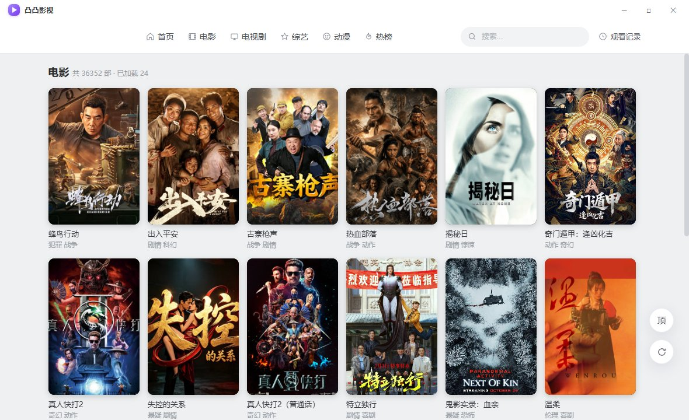
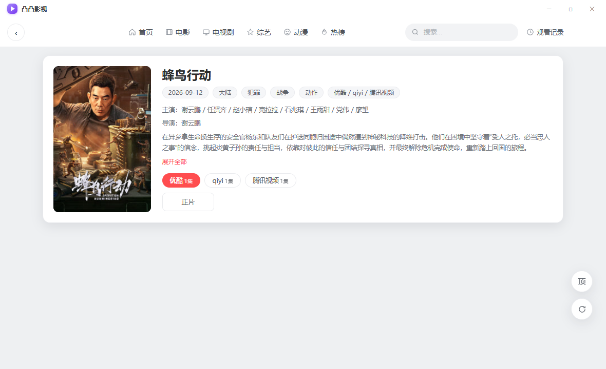
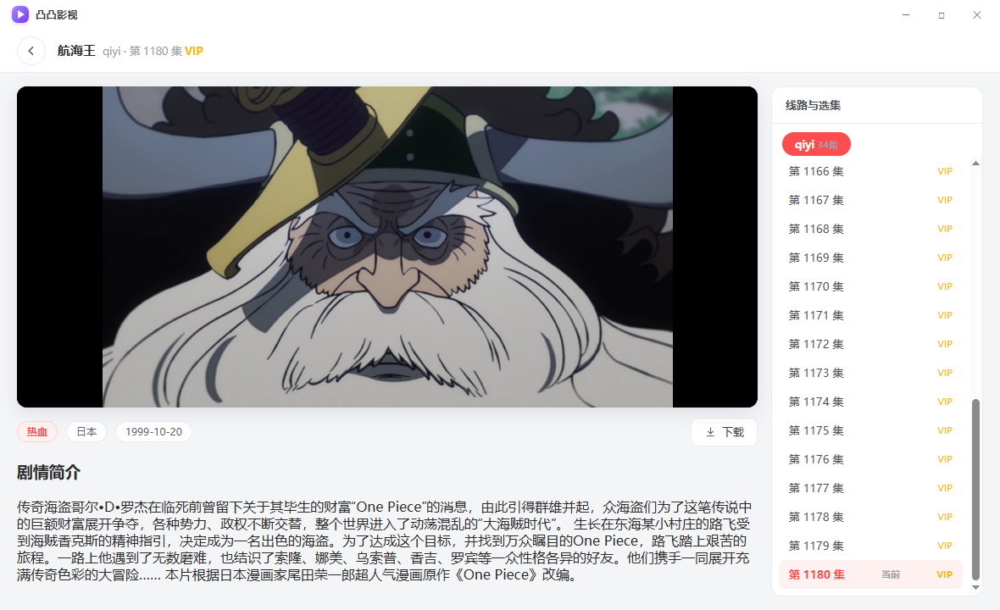

# 凸凸影视

一款 Windows 桌面端的轻量影视客户端。绿色单文件、免安装、双击即用，安装包体积 **≤ 10MB**。

## 特性

- **极简体积**：Tauri 2 + Rust + WebView2 原生壳，单文件 ≤ 10MB（x64）
- **纯本地运行**：绿色免安装，不写注册表、不留后台进程
- **桌面级体验**：无边框自绘标题栏；快捷键 `F5` 刷新 / `F11` 全屏 / `Alt + ← →` 前进后退；窗口最小化、最大化、关闭
- **自有数据管线**：Rust 侧代理内容源接口，请求头 / 超时 / 缓存全归自己掌控，绕开浏览器跨域限制
- **多源容灾**：上游自动故障转移，单源失效自动切换

## 功能

| 模块 | 说明 |
| --- | --- |
| 首页 / 排行 | 热门内容聚合与榜单 |
| 分类 | 电影 / 电视剧 / 动漫 等分栏浏览 |
| 详情 | 影片信息、选集、简介 |
| 播放 | 内置播放页，支持镜像源切换 |
| 搜索 | 关键词检索内容库 |

## 界面预览

| 首页 | 电影列表 |
| --- | --- |
|  |  |

| 影片详情 | 播放页 |
| --- | --- |
|  |  |

> 截图均来自实际运行界面，仅作功能展示。

## 获取软件

本程序通过 **QQ 群** 分发，不在本仓库公开提供下载。

- 加入官方 QQ 群：**1091505938**
- 扫码进群，按群公告领取 `凸凸影视.exe`

- 适用系统：Windows 10 / 11 64 位
- 首次运行若提示需要 Edge WebView2 运行时，按提示安装后即可（微软官方组件，非第三方）

## 使用说明

- 双击 `凸凸影视.exe` 启动（需系统已装 Edge WebView2 运行时，Win10 / 11 默认已带）
- 顶部导航：首页 / 电影 / 电视剧 / 综艺 / 动漫 / 热榜；右侧可搜索、查看观看记录
- 播放页支持镜像源切换、选集、全屏（影院模式）
- 快捷键：`F5` 刷新 ｜ `F11` 全屏 ｜ `Alt + ←` 后退 ｜ `Alt + →` 前进 ｜ 搜索框回车搜索
- 想加官方群？点软件右下角「加群」按钮，扫码即可进群

## 说明

本仓库仅作界面与功能展示，**不包含源代码**；程序通过 QQ 群分发，详见上方「获取软件」。
